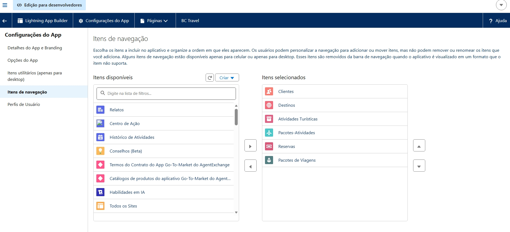
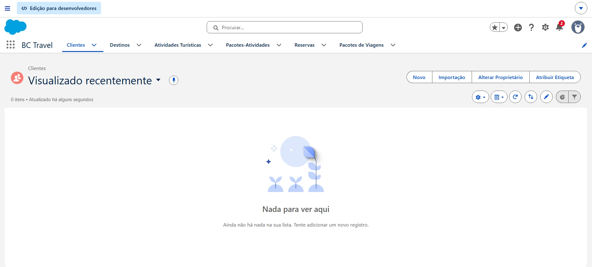
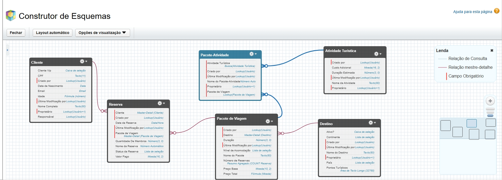
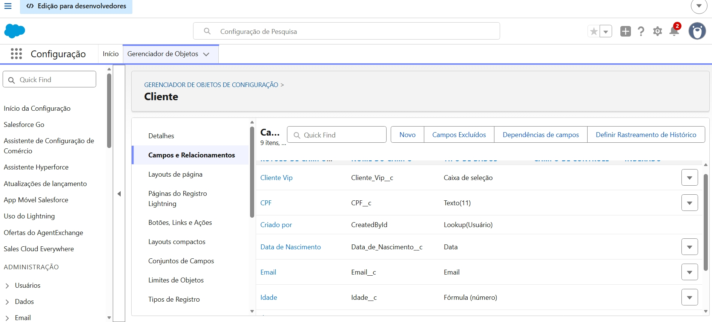
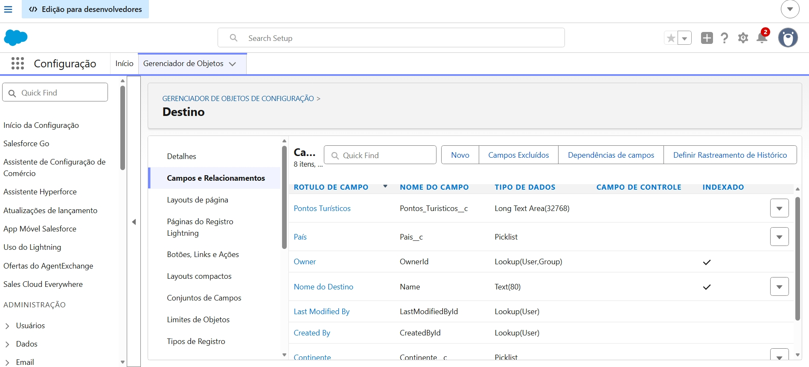
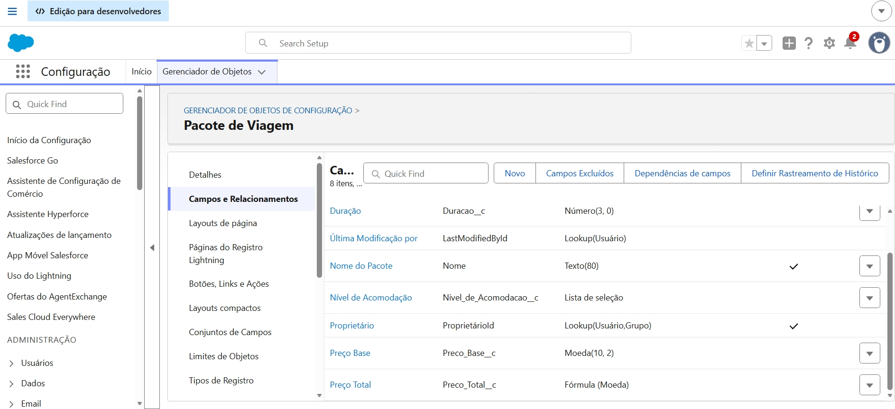
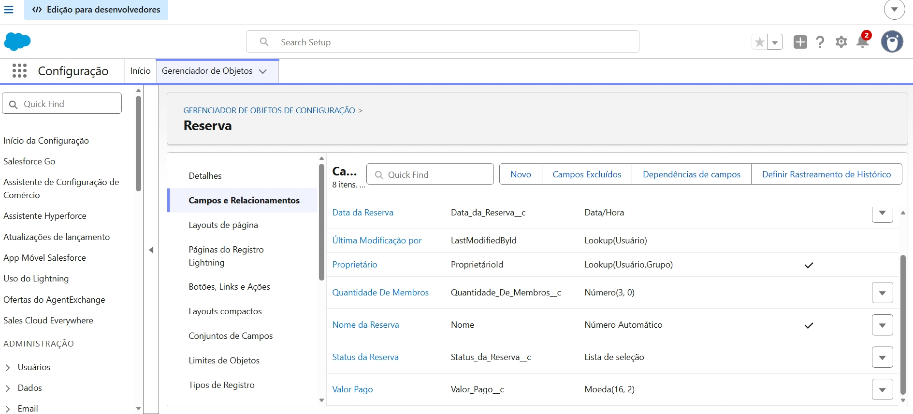

# ✈️ BC Travel — Gestão de Agência de Viagens no Salesforce

Projeto prático de **modelagem de dados no Salesforce** (Lightning Experience), baseado no case **TravelCorp** do curso **Corporação SalesForce** adaptado para a minha agência fictícia, a **BC Travel**.

O objetivo é praticar, em uma Developer Edition, o ciclo completo de construção de um app declarativo (*clicks, not code*): objetos personalizados, campos, relacionamentos, fórmulas, roll-up summary e validação com dados de teste.


---

## 📌 Sumário

- [Contexto e objetivos](#-contexto-e-objetivos)
- [Modelo de dados](#-modelo-de-dados)
- [Objetos e campos](#-objetos-e-campos)
- [Relacionamentos](#-relacionamentos)
- [Fórmulas e totalizações](#-fórmulas-e-totalizações)
- [Como reproduzir](#-como-reproduzir)
- [Testes realizados](#-testes-realizados)
- [Evidências (prints)](#-evidências-prints)
- [Aprendizados](#-aprendizados)
- [Próximos passos](#-próximos-passos)
- [Autor](#-autor)

---

## 🎯 Contexto e objetivos

Este projeto faz parte do meu estudo de Salesforce e tem como objetivos:

- Fixar o aprendizado com um ambiente próximo do dia a dia da profissão
- Treinar a resolução de problemas de modelagem de dados
- Estruturar um portfólio público com evidências do que construí

A estrutura é guiada por *cards* (user stories com critérios de aceitação), no estilo de um backlog real:

| Card | Entrega |
|---|---|
| 01 | Criação dos objetos personalizados |
| 02 | Campos do objeto Cliente |
| 03 | Campos do objeto Destino |
| 04 | Campos do objeto Pacote de Viagem |
| 05 | Campos do objeto Reserva |
| 06 | Campos do objeto Atividade Turística |
| 07 | Relacionamentos entre os objetos |
| 08 | Objeto de junção Pacote-Atividade (muitos-para-muitos) |
| 09 | Resumo de totalização no Pacote |
| 10 | Teste completo do modelo de dados |

---

## 🗂️ Modelo de dados

```text
 Destino ──(Master-Detail)──< Pacote de Viagem >──(Master-Detail)── Reserva ──(Master-Detail)──> Cliente
                                    │                                                              │
                                    └──< Pacote-Atividade >── Atividade Turística                  (Lookup)
                                          (junção N:N)                                                 │
                                                                                                    Usuário
```

> O diagrama real, gerado pelo **Schema Builder** do Salesforce, está na seção de [evidências](#-evidências-prints).

---

## 🧱 Objetos e campos

### Cliente
| Campo | Tipo |
|---|---|
| Nome Completo | Texto (nome do registro) |
| CPF | Texto (exclusivo) |
| E-mail | E-mail |
| Data de Nascimento | Data |
| Cliente VIP? | Caixa de seleção |
| Idade | Fórmula (Número) |
| Responsável | Relacionamento de pesquisa (Usuário) |

### Destino
| Campo | Tipo |
|---|---|
| Nome do Destino | Texto (nome do registro) |
| País | Lista de opções |
| Continente | Lista de opções |
| Pontos Turísticos | Área de texto longa |
| Ativo? | Caixa de seleção |

### Pacote de Viagem
| Campo | Tipo |
|---|---|
| Nome do Pacote | Texto (nome do registro) |
| Destino | Mestre-detalhe (Destino) |
| Preço Base | Moeda |
| Duração (dias) | Número |
| Nível de Luxo | Lista de opções (⭐ a ⭐⭐⭐⭐⭐) |
| Preço Total | Fórmula (Moeda) |
| Número de Reservas | Resumo de totalização (COUNT) |

### Reserva
| Campo | Tipo |
|---|---|
| Nome da Reserva | Numeração automática (`RES-{0000}`) |
| Cliente | Mestre-detalhe (Cliente) |
| Pacote de Viagem | Mestre-detalhe (Pacote de Viagem) |
| Data da Reserva | Data/Hora |
| Status da Reserva | Lista de opções (Pendente, Confirmada, Cancelada, Concluída) |
| Valor Pago | Moeda |
| Quantidade de Membros | Número |

### Atividade Turística
| Campo | Tipo |
|---|---|
| Nome da Atividade | Texto (nome do registro) |
| Duração Estimada | Número |
| Custo Adicional | Moeda |

### Pacote-Atividade (objeto de junção)
| Campo | Tipo |
|---|---|
| Pacote de Viagem | Relacionamento de pesquisa (obrigatório) |
| Atividade Turística | Relacionamento de pesquisa (obrigatório) |
| Ordem de Exibição | Número |
| Inclusa por padrão? | Caixa de seleção |

---

## 🔗 Relacionamentos

| Objeto filho | Objeto pai | Tipo |
|---|---|---|
| Pacote de Viagem | Destino | Master-Detail |
| Reserva | Cliente | Master-Detail |
| Reserva | Pacote de Viagem | Master-Detail |
| Cliente | Usuário | Lookup |
| Pacote-Atividade | Pacote de Viagem | Lookup |
| Pacote-Atividade | Atividade Turística | Lookup |

O objeto **Pacote-Atividade** resolve a relação **muitos-para-muitos** entre pacotes e atividades: um pacote pode ter várias atividades e uma atividade pode estar em vários pacotes.

---

## 🧮 Fórmulas e totalizações

**Idade do cliente** (Cliente)

```text
FLOOR((TODAY() - Data_de_Nascimento__c) / 365.25)
```

**Preço Total** (Pacote de Viagem) — o preço sobe 25% do Preço Base a cada estrela do Nível de Luxo:

```text
IF(ISPICKVAL(Nivel_de_Luxo__c, ""),
   Preco_Base__c,
   Preco_Base__c * (1 + (LEN(TEXT(Nivel_de_Luxo__c)) - 1) * 0.25))
```

| Nível | Multiplicador |
|---|---|
| ⭐ | 1,00 |
| ⭐⭐ | 1,25 |
| ⭐⭐⭐ | 1,50 |
| ⭐⭐⭐⭐ | 1,75 |
| ⭐⭐⭐⭐⭐ | 2,00 |

**Número de Reservas** (Resumo de totalização no Pacote de Viagem)

- Objeto resumido: Reservas
- Tipo: `COUNT`
- Depende do Master-Detail entre Reserva e Pacote de Viagem

---

## 🛠️ Como reproduzir

1. Crie uma **Developer Edition** gratuita em [developer.salesforce.com/signup](https://developer.salesforce.com/signup).
2. Crie o app **BC Travel** em *Configuração > Gerenciador de Aplicativos > Novo App Lightning*.
3. Crie os 6 objetos personalizados em *Gerenciador de Objetos > Criar*. Para a Reserva, use **numeração automática** no nome do registro.
4. Crie a **guia (aba)** de cada objeto (*Configuração > Guias > Guias de objeto personalizado*) e inclua-a no app BC Travel. Sem a guia, o objeto não aparece nos itens de navegação.
5. Crie os campos simples de cada objeto (seções acima).
6. Crie os **relacionamentos** com as tabelas ainda vazias (Master-Detail só pode ser criado em objeto filho sem registros).
7. Crie o **Resumo de totalização** (Número de Reservas) e a fórmula de Preço Total no Pacote de Viagem.
8. Crie o objeto de junção **Pacote-Atividade** com seus dois relacionamentos.
9. Insira registros de teste e valide (próxima seção).

---

## ✅ Testes realizados

Roteiro de validação do modelo (Card 10), usando dados fictícios:

- [ ] Criar um **Destino** (ex.: Roma, Itália, Europa)
- [ ] Criar duas **Atividades Turísticas**
- [ ] Criar um **Pacote de Viagem** ligado ao destino (Preço Base 1.000, nível ⭐⭐⭐)
- [ ] Conferir **Preço Total = 1.500**
- [ ] Criar um **Cliente** e conferir o cálculo da **Idade**
- [ ] Criar **duas Reservas no mesmo pacote** e conferir **Número de Reservas = 2**
- [ ] Conferir a numeração automática das reservas (`RES-0001`, `RES-0002`)
- [ ] Vincular as atividades ao pacote via **Pacote-Atividade**
- [ ] Verificar as listas relacionadas em Destino, Pacote e Cliente

---

## 📸 Evidências (prints)

### Estrutura do app

| | |
|---|---|
| **Objetos criados** |  |
| **App BC Travel** |  |

### Modelo de dados

**Schema Builder**



### Campos dos objetos

| Objeto | Imagem |
|---|---|
| Cliente |  |
| Destino |  |
| Pacote de Viagem |  |
| Reserva |  |

### Fórmulas e totalizações

| Evidência | Imagem |
|---|---|
| Fórmula do Preço Total |  |
| Pacote com Número de Reservas = 2 |  |

### Testes com dados

| Evidência | Imagem |
|---|---|
| Cliente com Idade calculada |  |
| Reservas com numeração automática |  |
| Atividades do pacote |  |

> Todos os dados exibidos são **fictícios**.

---

## 📚 Aprendizados

- Diferença entre **Lookup** e **Master-Detail** e quando cada um é necessário
- O **Resumo de totalização** só existe quando há Master-Detail com o objeto pai
- Um objeto só aparece na navegação do app se tiver **guia (aba)** criada
- Um Master-Detail só pode ser criado em objeto filho **sem registros**
- Um objeto aceita no máximo **dois** Master-Detail
- Uso de **objeto de junção** para relações muitos-para-muitos
- Fórmulas com `CASE`, `IF` e funções de texto para regras de preço
- Numeração automática como forma de reduzir erro de digitação

---

## 🚀 Próximos passos

- [ ] Criar **Validation Rules** (ex.: Valor Pago não pode ser negativo)
- [ ] Criar **Flows** (ex.: atualizar o status da reserva automaticamente)
- [ ] Montar **Páginas Lightning** e layouts personalizados
- [ ] Criar **relatórios e dashboards** (reservas por destino, receita por pacote)
- [ ] Configurar **perfis e conjuntos de permissões**
- [ ] Adaptar o modelo para um novo projeto de **gestão de logística**
- [ ] Estudar a evolução do projeto com Apex e LWC

---

## 👤 Autor

**José Carlos Almeida Trindade**

- GitHub: [github.com/jcalmeida-ds](https://github.com/jcalmeida-ds)
- LinkedIn: [linkedin.com/in/jcalmeida-datascience](https://linkedin.com/in/jcalmeida-datascience)

---

*Projeto educacional baseado no case TravelCorp, adaptado para a BC Travel.*
